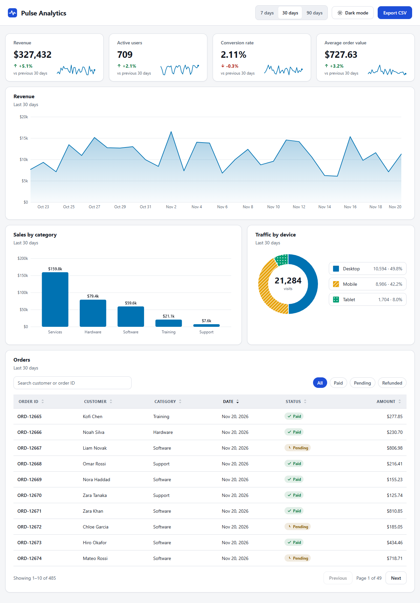
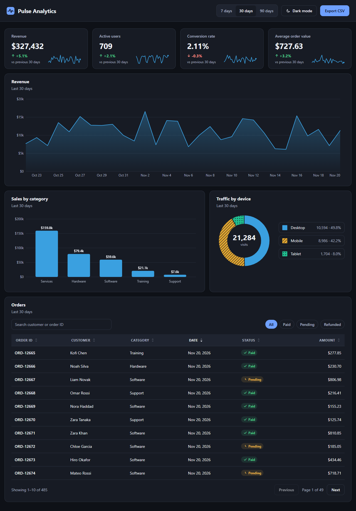

# Pulse Analytics

[](https://github.com/codewithfaseeh59/pulse-analytic-dashboard/actions/workflows/ci.yml)

**Live demo: [pulse-analytic-dashboard.vercel.app](https://pulse-analytic-dashboard.vercel.app/)**

A responsive SaaS analytics dashboard built with React and TypeScript. Every chart is hand-built SVG, with no chart library. The data is generated from a seed, so there is no backend and the numbers are the same on every visit.




## Features

- **KPI cards** for revenue, active users, conversion rate and average order value, each with the change versus the previous period and a sparkline.
- **Revenue area chart** with a hover/touch crosshair and tooltip, redrawn on resize. Arrow keys, Home, End and Escape work from the keyboard.
- **Category bar chart** sorted high to low, with a hover highlight and an entrance animation that respects `prefers-reduced-motion`.
- **Device donut chart** drawn from arc paths. Legend buttons toggle segments and the centre shows the visible total. Segments use patterns as well as colors.
- **Orders table** with column sorting (`aria-sort`), debounced search, status filter chips and pagination.
- **Date range** of 7, 30 or 90 days that updates every widget.
- **Light and dark theme**, remembered in `localStorage` and following the OS setting on first visit.
- **CSV export** of exactly the rows the table is currently filtered to.
- Skeleton loading states and an empty state.

## Tech stack

React 19, TypeScript (strict, no `any`), Vite, CSS variables with CSS Modules, Vitest and React Testing Library, ESLint (typescript-eslint strict, type-checked) and Prettier, GitHub Actions.

## Run it

```bash
npm install
npm run dev        # start the dev server
npm test           # run the tests in watch mode
npm run build      # typecheck and build for production
```

`npm run typecheck`, `npm run lint` and `npm run format:check` run the other CI checks.

## How the charts work

Each chart starts with a **scale**: a small function that maps data values to pixels. `linearScale` turns a revenue value into a y coordinate, `bandScale` gives each bar its position and width, and `niceTicks` picks round axis values such as 0, 5k, 10k instead of whatever the maximum happens to be. These live in `src/lib/scales.ts` and are unit tested.

The scaled points become SVG **path strings** in `src/lib/paths.ts`. A line is an `M` followed by `L` commands, the area is the same line closed down to the baseline, and each donut slice is an arc between two radii. A full 360 degree slice cannot be a single SVG arc, because its start and end points are identical, so it is drawn as two rings.

Charts redraw to their container with a `ResizeObserver` hook, so the SVG always has real pixel dimensions and text stays the same size. Hover maps the pointer x back to a data index with the scale's `invert`. For accessibility each chart has a text summary as its label and a visually hidden data table, and the area chart exposes a `slider` so keyboard and screen reader users can step through the days.

## Project structure

```
src/
  components/   Header, KpiCard, charts (Area, Bar, Donut, Tooltip), OrdersTable, ui primitives
  data/         seeded random generator and the mock dataset
  hooks/        useDashboardData, useOrdersTable, useResizeObserver, useTheme, ...
  lib/          pure helpers: scales, paths, format, csv, orders, dashboard (all tested)
  styles/       design tokens (light and dark) and global styles
  types/        shared types
```

## What I learned

- Writing scales and path generators myself made it clear how little a chart library does: it maps numbers to pixels and joins them into strings.
- Keeping the calculations in plain functions (`computeDashboard`, `filterOrders`, `sortOrders`) made them easy to test without rendering anything.
- Accessibility needs deciding early: a chart needs a text alternative, keyboard control and more than color to separate its data.
- Dates and timezones are easy to get wrong, so all date math here is done in UTC.
